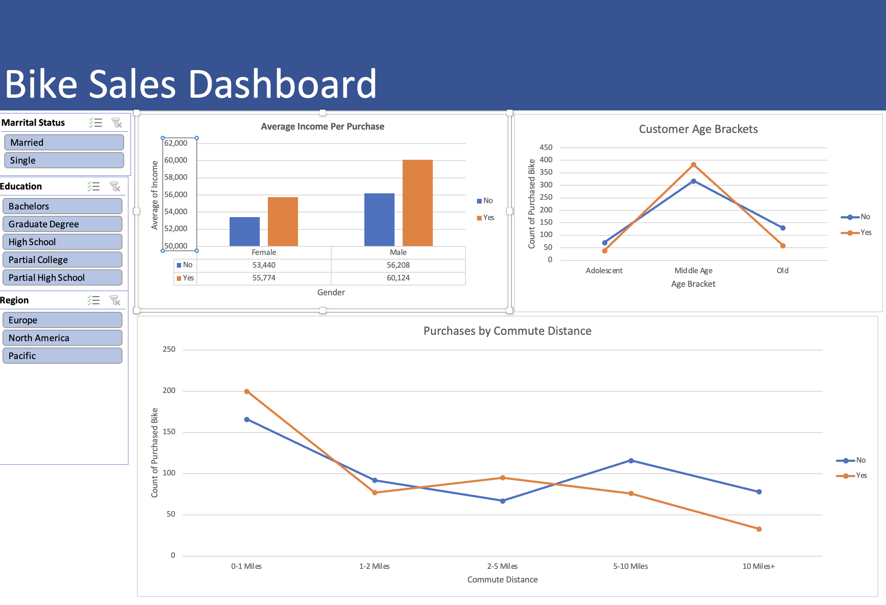

# Bike Sales Dashboard (Excel)

An interactive Excel dashboard exploring which customers are most likely to buy a bike, based on income, age, commute distance and region.

**[Download the Excel file](bike_sales_dashboard.xlsx)** to explore the dashboard and use the slicers.

## Questions explored

- Do bike buyers earn more than non-buyers?
- Which age groups are most likely to buy?
- How does commute distance affect purchasing?
- Which regions have the highest purchase rate?

## Data

A customer dataset of 1,026 records with demographic details (marital status, gender, income, children, education, occupation, home ownership, cars, commute distance, region, age) and whether each customer bought a bike.

The original data is kept untouched in the `bike_buyers` sheet. All cleaning happens in a separate `Working Sheet`.

## Data cleaning

- Removed 26 duplicate rows, leaving 1,000 unique customers
- Replaced coded values with readable labels (M/S to Married/Single, M/F to Male/Female)
- Created an `Age Brackets` column using a nested IF formula:
  `=IF(L2>54,"Old",IF(L2>=31,"Middle Age",IF(L2<31,"Adolescent","Invalid")))`

## What I built

- **Pivot tables** for average income by gender and purchase status, and purchase counts by commute distance, age bracket and age
- **Dashboard** with three charts: Average Income Per Purchase, Customer Age Brackets, and Purchases by Commute Distance
- **Slicers** for Gender, Marital Status, Education, Region and Purchased Bike, so the whole dashboard can be filtered interactively

## Key findings

- Buyers earn slightly more on average than non-buyers ($57,963 vs $54,875), and the gap holds for both men and women. The difference is modest, so income alone is not a strong predictor.
- Middle-aged customers (31 to 54) are the strongest segment, with about 55% buying a bike compared with around a third of younger and older customers.
- Short commutes drive purchases. Customers travelling under 5 miles buy at 46% to 59%, while those commuting more than 10 miles buy at only 30%.
- The Pacific region has the highest purchase rate (59%), ahead of Europe (49%) and North America (43%).

## Tools

Excel (data cleaning, nested IF formulas, pivot tables, pivot charts, slicers)
